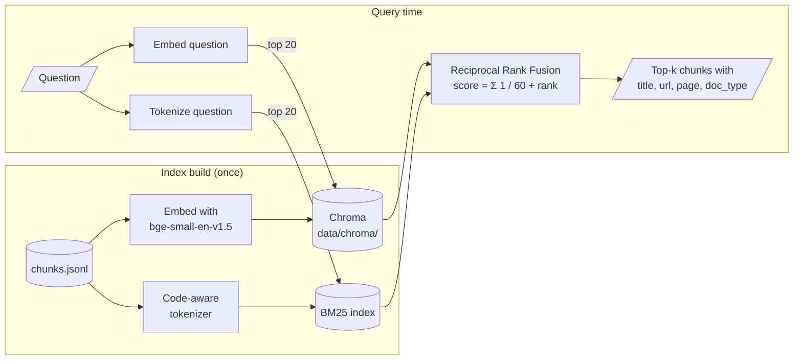
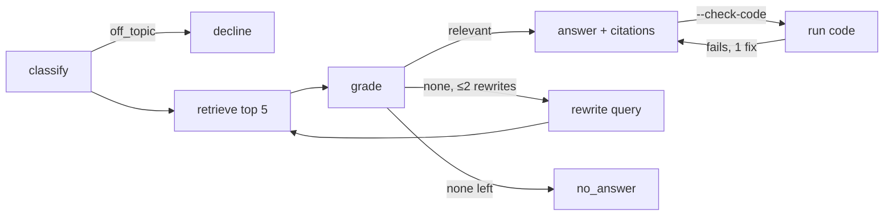

# document-assistant
Document Assistant for scikit-learn using RAG + LangChain + LangGraph.

Answers questions like *"how do I handle class imbalance in RandomForest?"* or *"what's the
difference between fit_transform and transform?"* using the official scikit-learn docs, with
citations to the exact page section.

## Setup

Requires Python 3.11 or 3.12 (PyTorch, needed later for fine-tuning, has no wheels for newer
versions yet).

```bash
python3.12 -m venv .venv
.venv/bin/pip install -e '.[dev]'
.venv/bin/pytest
```

## Pipeline

### 1. Ingest + section-based chunking

```bash
.venv/bin/python scripts/ingest.py
```

Downloads the official offline HTML docs and writes section-level chunks to
`data/processed/chunks.jsonl` (`data/` is gitignored).

**Design decisions**

- **HTML build, not the `.rst` sources on GitHub.** The API reference pages (e.g. every
  parameter of `GridSearchCV`) are generated from docstrings at build time, so they don't exist
  in the `.rst` files. The HTML also gives real URLs and section anchors to cite.
- **Version-pinned citations.** The docs are v1.9.1, and citation URLs point at
  `https://scikit-learn.org/1.9/...` rather than `/stable/`, so links keep matching the indexed
  text when a new release comes out.
- **Chunk by section, not by fixed size.** Sphinx wraps every heading in a
  `<section id="...">`, so each section becomes a chunk with URL `page.html#section-id`.
  Subsection text goes into its own chunk, not the parent's. Each chunk's text starts with its
  breadcrumb title (e.g. `Ensembles > Gradient-boosted trees > Usage`) so the embedding sees
  the context.
- **Special cases:**
  - API pages: one chunk for the class, one per method (`GridSearchCV > fit`).
  - Glossary: one chunk per term (`fit_transform`).
  - Code blocks are kept verbatim inside ``` fences.
  - Gallery script output is truncated (some examples print pages of warnings).
  - Fitted-estimator widgets in gallery output are replaced by their one-line text repr
    (the widgets embed parameter tables and docstring tooltips that duplicate the API pages).
  - Sections over 1400 characters are split on paragraph boundaries, to fit the embedding
    model's 512-token limit (see step 2); near-empty sections (headings, link lists) are dropped.
- **Excluded pages:** release notes, developer/contributor guides, team and governance pages,
  install instructions — they're about the project, not about using the library.

**Result:** 7,873 chunks — 4,355 API, 1,979 gallery examples, 1,325 user guide, 214 glossary.
Median chunk ~900 characters (~255 tokens), max 1,631.

### 2. Hybrid retrieval

```bash
.venv/bin/python scripts/build_index.py
```

Embeds the chunks into Chroma (~90 s on an M-series Mac) and prints results for a few sample
questions. The BM25 index is rebuilt in memory when the retriever loads (a few seconds), so
only the vector index is persisted. From code:

```python
from sklearn_assistant.retrieval.hybrid import retrieve

for r in retrieve("difference between fit_transform and transform", k=5):
    print(r.chunk["title"], r.chunk["url"], r.dense_rank, r.bm25_rank)
```

`mode="dense"` or `mode="bm25"` runs a single retriever, for comparison in step 3.



**Why both searches**

| | Dense (embeddings) | Lexical (BM25) |
|---|---|---|
| Matches | meaning: *"skewed classes"* → `class_weight` | exact names: `fit_transform`, `n_jobs` |
| Misses | close identifiers (`fit_transform` vs. `transform`) | synonyms and paraphrases |

**Design decisions**

- **Local embedding model (`BAAI/bge-small-en-v1.5`).** No API key or cost, re-indexing is
  free, and step 6 fine-tunes the embeddings, which needs an open model.
- **Code-aware BM25 tokenization.** Identifiers are indexed whole and split into parts
  (`fit_transform` → `fit_transform`, `fit`, `transform`), so both exact and partial matches score.
- **Reciprocal Rank Fusion.** Uses only ranks, so BM25 scores and cosine similarities never
  need to be put on the same scale.
- **Chunk length vs. model limit.** BGE truncates input at 512 tokens. With the original
  ~1500-token sections, 28% of chunks were cut off; splitting at 1400 characters brings that
  to 2.3% (dense LaTeX and numpy code), which BM25 still indexes in full.
- **Plain libraries behind one `retrieve(query, k)` function.** Step 3's evaluation gets
  full control over retrieval; step 4 wraps it as a LangChain retriever.

### 3. Retrieval evaluation

```bash
.venv/bin/python scripts/eval_retrieval.py      # scores dense, bm25 and hybrid
.venv/bin/mlflow ui --backend-store-uri sqlite:///mlflow.db
```

Runs every question in `eval/retrieval_questions.jsonl` through each retriever mode and logs
one MLflow run per mode (experiment `retrieval`): the metrics, overall and per category; the
config (embedding model, chunk size, RRF settings, eval-set hash, git commit); and a
`per_question.json` artifact with what each question retrieved, for digging into failures.

**The eval set:** 81 hand-written questions, each labeled with the 1–3 doc sections a good
answer would cite. They mix exact-identifier questions (*"What does `warm_start=True` do?"*)
with paraphrases that never name the class (*"How do I make sure samples from the same patient
don't end up in both the training and test folds?"*), across five categories: howto (49),
concept (15), comparison (8), api (5), troubleshooting (4).

**Metrics:** recall@5 (share of a question's gold sections in the top 5) is the headline
number. MRR (1 / rank of the first gold result, within the top 10), hit@5 and recall@10 add
context.

**Design decisions**

- **Labels are section URLs, not chunk ids.** Chunk ids change whenever the chunker does; URLs
  don't, so the set stays valid across steps. Any part of a split section counts as a hit, and
  the script refuses to run if a labeled URL is missing from the index.
- **Gold sections were picked by browsing the corpus, not from retriever output**, so the
  labels don't favor whichever retriever existed when they were written.
- **Strict labels.** Only the sections that directly answer a question are gold. Related
  gallery examples count as misses, so absolute scores are conservative; comparisons between
  runs are what matter.

**Baseline (81 questions)**

| mode | recall@5 | recall@10 | hit@5 | MRR |
|---|---|---|---|---|
| dense | **0.601** | **0.718** | **0.802** | 0.542 |
| bm25 | 0.430 | 0.564 | 0.617 | 0.416 |
| hybrid (RRF) | 0.553 | 0.642 | 0.765 | **0.559** |

Hybrid does *not* beat dense on recall: it is worse on 11 questions and better on 6. BM25's
misses are mostly near-relevant gallery examples that repeat the query's keywords (`plot_roc`,
`plot_lasso_*`), and equal-weight RRF lets them push correct dense results out of the top 5.
Weighting the fusion, and the cross-encoder reranker in step 6, are the obvious next levers.

### 4. LangGraph agent

```bash
cp .env.example .env    # then put your key in .env (gitignored)
.venv/bin/python scripts/ask.py "How do I handle class imbalance in RandomForest?"
.venv/bin/python scripts/ask.py --check-code "How do I plot a learning curve?"
```

**Why an LLM?** Steps 1–3 only *find* relevant doc sections; the LLM turns them into an
answer (RAG: retrieval-augmented generation). Retrieval alone can't explain or write code;
an LLM alone answers from memory, can be outdated or invent parameters, and can't cite.
Restricting it to the retrieved chunks and requiring citations makes answers checkable. Only
the **answer** step truly needs an LLM; **classify** (step 5) and **grade** (step 6, reranker)
are where cheaper models get compared against it.

**Why LangGraph?** The agent branches and loops (decline, rewrite and search again, give up,
fix code), so it's written as a graph: **nodes** are plain Python functions (`classify`,
`grade`, ...), **edges** pick the next step (some conditionally), and a shared **state** dict
carries the question, chunks and answer between them. Plain `if`/`while` code could do the
same at this size; LangGraph keeps the flow explicit (the wiring in `graph.py` *is* the
diagram), lets single nodes be swapped (steps 5–6), and gives step 8 streaming and tracing.



- **classify** labels the question (the eval categories + `off_topic`); off-topic is declined.
- **grade** keeps only the retrieved chunks that help answer; if none do, **rewrite** turns
  the question into docs vocabulary and searches again (at most twice).
- **answer** uses only the kept chunks and cites them `[1]`, `[2]`. With no relevant chunks it
  returns a fixed "not in the docs" reply instead of answering from memory.
- **check_code** (opt-in) runs the answer's code; on failure the answer is regenerated once
  with the traceback, and if it still fails the answer carries a warning.

**Design decisions**

- **Anthropic SDK directly, no LangChain wrappers.** LangGraph nodes are plain functions; two
  calls (`structured()` for routing, `text()` for answers) cover everything. All calls use
  `claude-opus-5-5`, with low effort for routing and medium for answers, and structured outputs
  so routing never parses free text. Refused requests fall back server-side
  (`fallbacks: "default"`).
- **Dense retrieval in the agent**, since it beat hybrid on recall@5 in step 3.
- **The code check is not a security sandbox**: a subprocess with a temp dir, stripped env
  and timeout, running as your user. That's why it's off by default; step 8 moves it to Docker.
- **Tests use a scripted fake LLM and retriever**, so the graph's routing is tested without
  an API key.

## Roadmap

- [x] 1. Ingest + section-based chunking
- [x] 2. Embeddings + Chroma, BM25 + hybrid retrieval
- [x] 3. Evaluation set (81 questions) + recall@5 / MRR, tracked in MLflow
- [x] 4. LangGraph agent: classify → retrieve → grade/rewrite → answer (+ code sandbox)
- [ ] 5. Question classifier: TF-IDF + LR vs. fine-tuned BERT vs. LLM
- [ ] 6. Fine-tuned embeddings + cross-encoder reranker
- [ ] 7. Answer evaluation (faithfulness, correctness)
- [ ] 8. FastAPI + Docker, Streamlit UI, tracing

The evaluation set comes right after retrieval (before the agent) so the plain-embeddings
baseline gets measured first, and every later improvement shows up as a number in the final
comparison table.

## Layout

```
src/sklearn_assistant/
  config.py            paths, docs URL, citation base URL
  ingest/download.py   fetch + unzip the offline docs
  ingest/chunker.py    HTML -> section-level chunks
  retrieval/dense.py   embed chunks -> Chroma; query
  retrieval/bm25.py    code-aware tokenizer + BM25 index
  retrieval/hybrid.py  RRF fusion -> ranked chunks
  evaluation/retrieval.py  eval set loading, recall@k / MRR scoring
  agent/graph.py       LangGraph state machine (nodes + routing)
  agent/prompts.py     prompts and structured-output schemas
  agent/llm.py         Claude API wrapper
  agent/sandbox.py     runs answer code in a subprocess
scripts/ingest.py      step 1 entry point
scripts/build_index.py step 2 entry point
scripts/eval_retrieval.py  step 3 entry point (logs to MLflow)
scripts/ask.py         step 4 entry point (ask the agent)
eval/retrieval_questions.jsonl  hand-labeled retrieval eval set
tests/                 pytest suite
```
